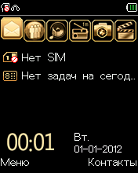

# B220: домашний экран, JPEG и ускорение

**Следующий этап уже выполнен:** добавлены экранные кнопки и ввод с клавиатуры.
[Текущий запуск и управление](BUTTONS_RU.md). Ниже — отчёт о предыдущем этапе;
его утверждения об отсутствии клавиш и конечной остановке GUI относятся к той версии.

Актуально на 1 ноября 2026 года. Исходная прошивка выполняется без патчей до
домашнего экрана: цветные значки, «Нет SIM», часы, дата, «Меню» и «Контакты».
В другом сохранённом состоянии сначала появляется окно настройки даты.
Клавиши телефона пока не подключены, поэтому управление меню ещё не проверено.



## Запуск

Закройте старое окно и дважды щёлкните `Explay B220.lnk` или `Start B220.cmd`.
Сначала появляется заставка, затем интерфейс. Полный контрольный запуск из окна
занял около минуты на текущем компьютере; сохранённые настройки и нагрузка
компьютера влияют на время. Это ещё не эмуляция с реальной скоростью телефона.

Окно намеренно заканчивает запуск после **пяти полных обновлений LCD**. Для
текущей прошивки и подготовленной NOR это первый экран MMI: домашний экран или
настройка даты. В статусе написано «Экран интерфейса — контрольная точка».
Это условие остановки для просмотра, а не ошибка декодера. При длительном
выполнении без ввода гость позднее гасит экран; клавиш для пробуждения пока нет.

Живые кадры, масштаб, сохранение PNG и журнал работают. Обычное окно сохраняет
только виртуальную flash в `analysis/emulator/window-nor-v2.bin`; CPU и RAM при
перезапуске начинают загрузку заново. Исходные ZIP, PAC, PS и NV не изменяются.

```powershell
# Как в окне: остановиться после пяти полных обновлений LCD
.\run_emulator.ps1 -Frames 5

# Продолжать до лимита, без этой контрольной точки
.\run_emulator.ps1

# Отдельная NOR, живой экран и отдельный отчёт
.\.venv\Scripts\python.exe -m emulator.run --explore --instructions 200000000 --seconds 180 --frames 5 --load-flash analysis/emulator/window-nor-v2.bin --save-flash analysis/emulator/my-nor.bin --live-frame analysis/emulator/my-live.png --out analysis/emulator/my-run.json
```

## JPEG

Прежняя остановка `0x5e118c → 0x20200000` пройдена. Реализован тот аппаратный
путь, который использует текущая загрузка:

| Узел | Наблюдение и модель |
|---|---|
| Табличный порт | Control `0x19` запрашивает доступ, bit7 подтверждает готовность; `9` возвращает обычный режим. Драйвер: `0x2ffd08` |
| Битовый поток | `0x20210408` задаёт число бит и peek/consume, `+10` отдаёт значение, `+14` — позицию; указатель `+04` задаётся в 32-битных словах |
| Квантование | Гость программирует `0x20200300..3fc`; два значения в слове, индексы переставлены обращением шести бит. Для libjpeg восстанавливается таблица JPEG |
| Хаффман | Поддержаны точно наблюдавшиеся стандартные DC/AC-таблицы. Совпадение проверяется по содержимому аппаратных таблиц, нестандартные/неполные явно отклоняются |
| Запуск | Запись `1` в `0x20210800`, размер порции в `+7c`; путь драйвера `0x2c7658` |
| Прогресс | `0x20211808` возвращает строку/столбец MCU, `+10` bit2 — завершение, `0x20200068` — отсутствие занятой передачи |
| Выход | RGB565 big-endian в RAM по `0x20200058 << 8`. Записываются только завершённые MCU каждой порции |

Первое изображение — **773 байта без обычного JPEG-заголовка**, 176×224,
субдискретизация 4:2:2. Размеры и таблицы пришли отдельно через регистры.
По этим данным собирается JPEG для Pillow/libjpeg. Конец entropy scan находится
разбором кодов Хаффмана и количества MCU: в декодер не попадают соседние данные RAM.

Это модель периферии: ARM-код продолжает исполнять драйвер, опрашивает прогресс,
проверяет завершение и сам рисует дальнейший интерфейс. Функции прошивки не
пропускаются, их возвращаемые значения и экранные буферы не подменяются готовой
картинкой интерфейса.

Проверен также отдельный **цветной JPEG** с другой таблицей квантования: результат
RGB565 совпадает побайтно с декодированием исходного файла. Первый ресурс самой
прошивки даёт чёрное изображение; тест с цветом проверяет, что модель действительно
декодирует вход, а не только заполняет чёрный буфер.

На момент этого этапа работали baseline 4:2:2 и линейный RGB565 через опрос.
Теперь добавлены 4:2:0, выход Y/CbCr с чередованием буферов и IRQ26 для
просмотрщика файлов. [Актуальные результаты и ограничения](JPEG_PLANAR_RU.md).
Progressive, нестандартные таблицы и аппаратное масштабирование ещё не
реализованы; завершение порции в модели синхронное. Точность IDCT и цветовых округлений настоящего
чипа без телефона не измерена. Неподдерживаемые команды/режимы останавливаются
с явной причиной, а не получают фиктивный результат.

## Прямоугольные обновления LCD

После JPEG прошивка дошла до нового режима DMA. Прежняя модель понимала только
сплошной framebuffer, поэтому останавливалась при первой перерисовке курсора.

Младшие 16 бит config задают байты строки. Source frame step содержит шаг от
последнего элемента строки до первого элемента следующей. Наблюдаемая область
16×16 пикселей задаёт config `0x04880020`, count `512`, frame step `0x142`:
32 байта данных в строке берутся из framebuffer с шагом 352 байта.
Реализация выбирает нужные строки и передаёт их в окно GRAM, заданное гостем.

Регрессионный тест помещает посторонние байты в промежуток между строками:
они не должны появляться среди пикселей. Продолжительный прогон проходит
82 DMA-передачи, включая мигающий курсор, без прежней остановки.

## Ускорение

Профилировщик обнаружил большие накладные расходы в обработчике каждого блока
ARM-кода, особенно в повторном выборе Python-типа CPSR при чтении регистра.

Теперь используется тот же проверяемый вызов Unicorn `uc_reg_read` с заранее
известным 32-битным типом. Публичный путь сохранён как эталонный и запасной.
Таймеры проверяются при ближайшем сроке события, а не дважды на каждом блоке;
перепрограммирование пересчитывает этот срок. Отладочные строки читаются порциями
вместо отдельного вызова на каждый байт.

Последовательное сравнение до `0x17e8fc`: **21,627 → 14,475 секунды, 1,494×**.
Совпали RAM, SRAM, flash, регистры CPU, LCD, последовательность IRQ, таймеры,
число выполненных блоков и сообщения гостя. Изменение виртуального времени
или пропуск функций для получения ускорения не использовались.

[Полные данные сравнения](analysis/emulator/performance/comparison.json).
Повторение: `python -m tools.benchmark_runtime` в локальном `.venv`.
Это замер конкретного участка; его коэффициент нельзя автоматически переносить
на весь старт или считать доказательством точных аппаратных таймингов.

В полном запуске из окна первый кадр появился примерно через 3 секунды. Основное
ожидание было до начала следующих обновлений, при инициализации MMI/NV/EFS.
Нормальная скорость всей анимации пока не достигнута.

## Контрольные точки и проверки

`tools/research_runtime.py` сохраняет CPU, RAM и состояние периферии для локальных
исследований. Возврат к точке перед JPEG позволяет повторить путь до интерфейса
за несколько секунд. Это внутренний формат для той же версии Python/Unicorn,
а не формат обычной виртуальной NOR и не продолжение из кнопки «Перезапустить».

- `34-before-jpeg` / `35-restored-boundary`: сохранение и точное воспроизведение прежнего рубежа.
- `36-jpeg-register-poll`: исследовательский прогон с одними регистрами; это ещё не рабочий декодер.
- `39-after-jpeg`: первый экран даты и обнаружение прямоугольного DMA.
- `40-ui-after-jpeg`: продолжительная работа, перерисовка курсора, реакция на бездействие.
- [41-date-screen](analysis/emulator/41-date-screen.html): экран даты из контрольной точки.
- [Полный запуск из окна](analysis/emulator/window-screen-test.html): домашний экран после reset.
- [Проверка окна](analysis/emulator/window-screen-check.json).

**33 теста прошли.** Они включают настоящую загрузку PS до MMI/RTC, загрузочный
обмен DSP, ARM/Thumb IRQ/return, NOR, блокировку PNG в Windows, цветной JPEG,
частичную готовность выходных блоков и выбор строк прямоугольного DMA.

Следующая работа — клавиатурный контроллер и ввод: открыть меню, подтвердить дату,
проверить дальнейшую работу интерфейса. Затем расширять JPEG и прочую периферию
по реально встречающимся операциям. Работа DSP-кода, радиотракт и полная
аппаратная точность остаются отдельными этапами.
